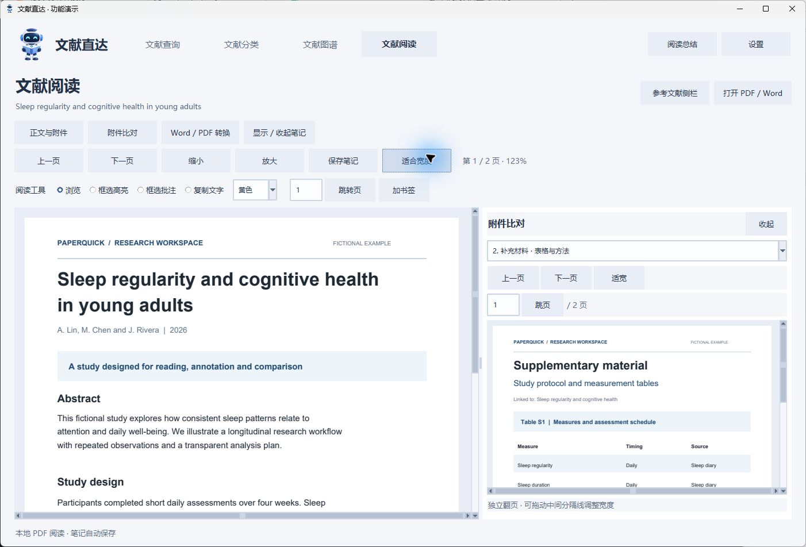
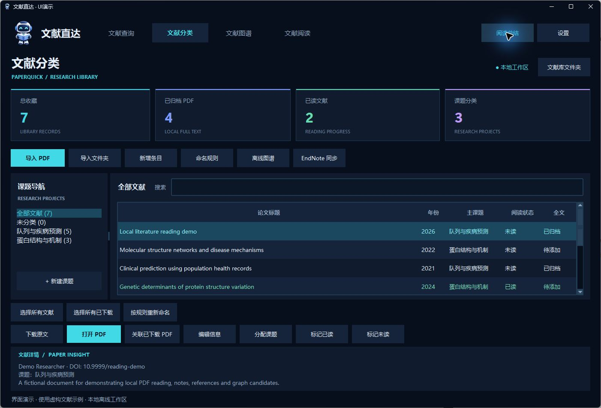
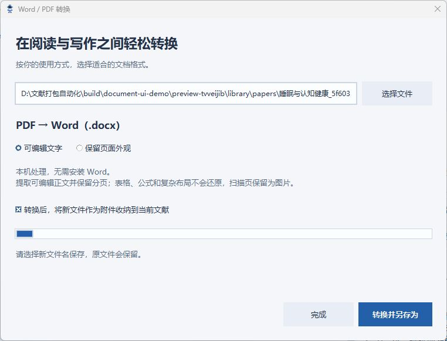
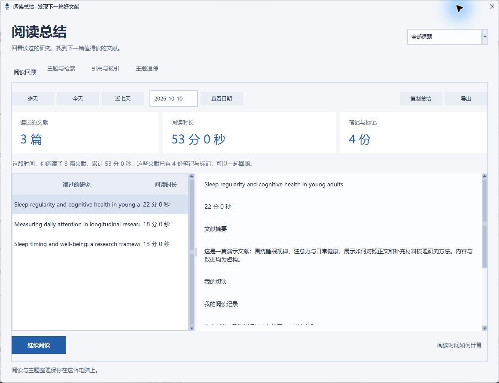

# 文献直达 · PaperQuick

从导师发来的一个标题，到课题文件夹里的一篇论文，再到阅读笔记和写作引用。Windows 本地文献工作区，连接 **查询 → 下载归档 → 分类与附件 → 阅读比对 → 关系探索 → 阅读回顾 → Word 写作**。

[下载 v3.2 Windows 版](https://github.com/J0ey2ou/PaperQuick/releases/download/v3.2.0/PaperQuick-v3.2-Windows.zip) · [版本说明](https://github.com/J0ey2ou/PaperQuick/releases/tag/v3.2.0) · [v3.2 使用指南](docs/v3.2-local.md) · [English](#english) · [参与协作](CONTRIBUTING.md) · [微信图文介绍](推送文案.md)

**v3.2 新增**：Word 导入与分页预览、Word / PDF 互转、文献附件关联与并排比对、31 套 Word 引用格式，以及主题关键词、检索式、引用与被引探索和新文献追踪。

无需安装 Python，无需注册账号。整理、阅读、图谱和总结在本机完成，不调用外部 AI、不需要 AI API Key；检索和下载需要联网。

## 安装与升级

1. 在 Releases 下载 `PaperQuick-v3.2-Windows.zip`，解压完整文件夹到可写目录。
2. 双击 `文献直达.exe`，保留同目录的 `全局选词助手.exe`、`browser-extension` 和说明文件。
3. 复制一个英文标题或 DOI，在 **文献查询 → 粘贴并查找** 试用。
4. 升级时先从托盘 **退出文献直达**，备份原文件夹，再覆盖程序文件。保留 `本地文献库`、`settings.json`、`shortcut.json`，不要用空库替换旧库。备份请在退出后复制完整 `本地文献库`，其中包含文献信息、正文、附件、笔记和阅读记录。

面向 Windows 10 / 11 64 位。**Word 分页预览、Word 转 PDF 和插入 Word 引用需要本机安装桌面版 Microsoft Word**；PDF 转 Word、PDF 阅读和 DOCX 导入归档不要求安装 Word。需要 Word 的功能目前不支持用 WPS 或 Word 网页版替代。发布包不含个人文献或演示库；截图中的文献与阅读时长均为虚构演示。

## 查询：三种入口

- **粘贴查询**：支持完整英文论文标题、DOI、arXiv 编号 / 链接和可读取的推送链接。粘贴后点击查找，或按 `Ctrl + Enter`。结果逐步显示，可核对作者、年份和 DOI，再打开或复制地址。
- **Word / PDF / 微信电脑版选词**：启动全局选词助手，选中可复制文字，按托盘显示的快捷键。右上角 **设置 → 快捷键 → 保存并启用** 可修改，例如 `Ctrl + Alt + J`。默认先尝试 `Ctrl + Alt + F`；占用时使用备用键，以实际显示为准。系统范围使用快捷键，原生应用没有统一右键菜单。
- **Edge / Chrome 右键**：打开 `edge://extensions` / `chrome://extensions`，开启开发者模式，加载解压后的 `browser-extension`。选中标题 / DOI，右键 **查找文献并打开原文**。当前推送页面也可右键查询；扩展独立运行，桌面端负责本地文献库。更新扩展后点击重新加载。

单个 DOI / arXiv 有直接入口时可先打开；匹配明确的标题查询可自动打开。服务缓慢时使用 **直接学术搜索**。遇到公众号验证，先在浏览器完成验证，再选中英文标题 / DOI；软件不绕过验证或机构付费权限。

## 下载、课题分类和命名

1. 查询结果点击 **收藏 / 下载归档**，选择或新建课题。可下载的直接 PDF 自动归档；需要网页操作时打开对应全文 / 出版社页面。
2. **文献分类 → 导入 PDF / Word** 支持 PDF、DOCX、DOC；**导入文件夹** 包含子目录中的这些文档。还可手工新增条目和编辑信息。右键 **下载原文（打开下载页面）** 跳转对应页面；**下载并自动归档** 查找开放版本并保存。
3. 浏览器完成机构登录并下载的 PDF，通过 **关联已下载 PDF** 或 **导入 PDF / Word** 归档。当前不监控浏览器下载目录，不会猜测新下载文件属于哪篇文献。
4. **命名规则** 支持 `{年份}`、`{第一作者}`、`{标题}`、`{DOI}`、`{课题}`，例如 `{年份}_{第一作者}_{标题}`。英文占位符也可用：`{year}_{author}_{title}`。
5. 选中文献后右键 **按规则重新命名**。可使用 **选择所有文献 / 选择所有已下载文献**（全库范围，会清除筛选），或 Ctrl / Shift 多选。确认预览后批量应用各条目主课题的规则。文件保留 PDF、Word 或其他真实扩展名；补充材料带独立名称和后缀，网址附件不参与重命名。没有本地文件的条目跳过，同名文件自动加后缀；原始导入文件不改动。

“已归档正文”统计 PDF 或 Word 主文件，只有补充材料或网址的文献仍可继续查找正文。重新导入相同文件会复用记录；归档副本丢失时会恢复附件，保留其名称、关联笔记和批注。原位置存在不同内容时另存一份，避免覆盖。

## Word / PDF 互转与附件比对

1. **关联附件**：在文献分类选中论文，右键 **附件管理 / 比对阅读**，或在阅读页点击 **正文与附件**。点击 **添加文件** 收纳补充 PDF、Word、表格等；点击 **添加网址** 保存补充材料或相关网页链接。可以 **修改名称**，也可将 PDF / Word **设为正文**。
2. **并排阅读**：在附件列表选中 PDF 或 Word 后点击 **并排阅读**。正文在左、附件在右，两侧分别翻页、跳页；拖动分隔线调整宽度，右侧下拉框可换附件。阅读页的 **附件比对** 可再次唤出，**显示 / 收起笔记** 可腾出空间。
3. **页内转换**：点击阅读页 **Word / PDF 转换**，或分类列表右键 **Word / PDF 互转**。选择文件，点击 **转换并另存为**，使用新的文件名保存。Word 转 PDF；PDF 转 DOCX 时可选 **可编辑文字** 或 **保留页面外观**。
4. **转换后继续整理**：勾选 **转换后，将新文件作为附件收纳到当前文献**，新文件会自动关联，原文件保留。只有从文献条目进入时才能使用这一关联选项。

PDF 转 Word 在本机完成，无需安装 Word：默认 **可编辑文字** 提取可复制的正文并保留逐页分隔，不还原图表和复杂排版；没有可提取文字的扫描页以原页图片保留。**保留页面外观** 把每页作为图片放入 DOCX，页面内容可查看，文字不能直接编辑。两种模式都不提供 OCR。

Word 阅读显示分页预览，不提供页内 Word 正文编辑；要修改稿件，可在附件列表点击 **外部打开**。网址在浏览器打开，表格等其他附件交给本机对应软件。Word 转 PDF 和 Word 分页预览使用本机 Word 与字体；缺失字体可能影响版式。转换结果请按用途核对。

正文与附件共用这篇文献的阅读笔记；高亮、书签和批注跟随对应文件。将另一份附件设为正文不会把原文件批注搬到新页面，切回原文件即可继续查看。右侧比对区用于独立翻阅，不单独累加一份阅读时长。详见 [文档与附件使用指南](docs/documents-and-attachments.md)。

## 阅读、笔记、批注和参考文献

- 从分类、图谱等内部入口打开正文，进入 **文献阅读**；也可点击 **打开 PDF / Word**。支持翻页、跳页、适合宽度、缩放和书签。
- 右侧笔记可直接编辑、撤销 / 重做、加粗、斜体、插入页码、插入研究笔记模板及导出。编辑后自动保存，也可点击 **保存笔记** 或在笔记区按 Ctrl+S。
- **阅读区右键 → 添加阅读笔记**，快速插入当前页记录；有当前页最近框选文字时一并带入。右键还可在点击位置添加批注和书签。
- 阅读工具支持 **框选高亮 / 框选批注 / 复制文字**，拖出选区即可操作；批注列表支持定位、编辑、删除，颜色可选。
- **参考文献侧栏** 可独立打开。优先保留原始编号；显示 `1*` 等星号时只是提取顺序，原编号未识别，请回原文核对。条目可查原文、下载归档或收藏到课题。
- 笔记、书签和批注存放在本地库，PDF 原文件不改写，其他阅读器不会自动显示本软件批注。扫描版 PDF 和复杂分栏可能无法正确提取文字或引用，当前不内置 OCR。

## 离线图谱

**收藏概览** 查看课题分布；**文献关系** 查看标题、摘要、关键词的文本相似关系及本地 PDF 中的 DOI 引用证据。

拖动文献数滑条控制密度；滚轮缩放，拖动空白区平移，Shift 框选区域放大，双击节点聚焦邻居，重置视图返回全局。点击概览的课题区域可查看对应部分。节点详情可继续打开 PDF、查询原文或收藏候选。

未入库候选来自本地参考文献，以虚线区分，并非在线全领域推荐。高亮可按阅读次数、本地引用次数、是否下载，或自定义颜色和权重。**本地引用次数不等于全球被引次数**，文本相似也不代表已验证的学术引用。

## 阅读总结：回顾阅读，继续发现

点击右上方 **阅读总结**，打开独立弹窗。原来的查询或阅读页面留在原处，关闭弹窗即可继续；后台启动时不会打断你。弹窗有四个栏目：

1. **阅读回顾**：选择昨天、今天、近七天或指定日期，也可按课题查看。浏览读过的文献、阅读时长、摘要、笔记和摘录；选中一篇即可继续阅读，整份回顾支持复制和导出。
2. **主题与检索**：从所选课题的文献库，或所选时段读过的文献中，整理主题关键词。双击关键词加入检索，或自行修改，用分号分隔。选择 **PubMed / Web of Science / Google Scholar / Europe PMC**，生成检索式后可继续编辑、复制或打开对应网站。Web of Science 会先复制检索式，再打开高级检索页面供你粘贴。
3. **引用与被引**：选一篇已收藏的文献作为起点，查找 **它引用的文献**、**引用它的文献**，或同时查看两个方向。软件会略过已经收藏的文献；选中新的发现，可查找原文或收藏到指定课题。每条发现保留与起点文献的关系，方便回看线索。
4. **主题追踪**：从“主题与检索”点击 **关注这个主题**，或手动新增主题，填写名称和 Europe PMC 检索式并保存。点击 **查找新文献** 即可检查；勾选 **每天检查一次（软件运行时）** 后，在软件保持运行且能够联网时每天自动检查一次。关闭软件后不会检查，也不会为此唤醒电脑。

主题追踪中的 **历次发现** 可回看每次结果。**撤回这次发现** 只收起这一批结果，之后可以恢复；已经收藏的文献、PDF 和阅读笔记都会保留。检索失败时可手动重试，不会清空过去的发现。一次结果过多时会提示仍有更多文献，可缩小检索范围再检查。

阅读时间只计算 **文献已打开、阅读页面处于前台** 的停留时间。切到其他软件、打开总结、切换页面或收起窗口时暂停。它帮助你回顾阅读安排，不代表已经读完或理解了文章；升级前未记录的时间无法补算。回顾展示目前保存的摘要、笔记和摘录，之后修改笔记，再次查看时也会更新。

关键词来自文献标题、摘要和原有关键词，在本机整理，不需要外部 AI。检索式是继续探索的起点，可按研究问题增删词语。**引用探索和主题追踪使用 Europe PMC 的公开文献数据，无需申请密钥，主要覆盖生命科学与医学；引用关系并不包含所有数据库中的全部结果。** 某篇文献没有查到关联，不代表它没有参考文献或从未被引用。查找新文献与原文需要联网，全文能否下载仍取决于开放情况和访问权限。

详细操作见 [v3.2 使用指南](docs/v3.2-local.md)。

## 设置、皮肤和后台运行

右上角 **设置** 是独立页面，支持 **深空蓝 / 极光紫 / 石墨灰 / 极简浅色**，切换立即预览，保存后下次沿用。可设置快捷键、可选 Unpaywall 联系邮箱、**登录 Windows 后后台启动**。

关闭主窗口收起到系统托盘，双击托盘恢复；右键托盘可打开文献库、设置或完整退出。重复启动唤起同一窗口。启用 Windows 登录启动后先驻留后台，可在设置取消。没有账号登录体系或鼠标跟随浮窗。

## Word 引用

在 **文献分类 → Word 引用**，或选中文献后右键 **插入 Word 引用 / 参考文献**。先在 Windows 桌面版 Word 打开文档、放好光标，再连接并核对文档名称。选择格式与文献后，可插入正文引文，在文末生成参考文献表；移动、删除引文或改换格式后，点击 **更新全部引用 / 切换格式** 统一整理。

内置 **31 套常用 CSL 格式**：GB/T 7714 数字编号 / 作者年份、APA、Vancouver、IEEE、Chicago 作者年份、MLA、Harvard，以及 Nature、Science、Cell、The Lancet、NEJM、AMA、ACS 等。还可导入更多期刊的 `.csl` 样式。排版在本地完成，无需 AI、账号或 Word 宏；引用信息可手动编辑，也可按 DOI 联网补全。

本版支持正文中的数字编号和作者年份引用；暂不支持脚注、尾注、Word 网页版或 WPS。软件仅更新自身插入的引用，与其他引用工具分别管理。每次更新可用 Word 撤销，文档需自行保存。操作细节见 [Word 引用使用指南](docs/word-citations.md)。

citeproc-js implements the Citation Style Language · © Frank Bennett. [Citation Style Language](https://citationstyles.org/)。随程序附带原始许可证与来源说明。

## EndNote 兼容范围

针对 EndNote 22.3 提供只读导入、附件归档、差异 / 冲突预览及 XML 交换包。请先用备份库测试，保留 `.enl` 和对应 `.Data`。

**已有 EndNote 记录的全自动双向写回尚未实现。** 当前可以从 EndNote 导入本地、导出本地修改及 XML 交换清单，再在 EndNote 中导入或人工核对已有记录；导入完整库可能产生重复。软件不直接修改 EndNote 私有数据库。本软件笔记、图谱、批注和计时不会自动同步为 EndNote 对应功能。

## 数据与网络

文献库、正文、附件、笔记、批注及阅读时长保存在程序目录的 `本地文献库`。Word 预览、文档转换和引用排版在本机完成。检索会将标题 / DOI 发送给文献服务，网页链接会向目标站点请求；可选 Unpaywall 邮箱随 DOI 查询发送给该服务。主题追踪向 Europe PMC 发送保存的检索式；引用探索发送起点文献的 DOI 或标题及查找所需的文献编号，DOI 补全向 Crossref 发送 DOI，不上传 Word 稿件、PDF 正文、阅读笔记或完整文献库。服务可能限流、验证或没有开放全文，原文入口不保证免费 PDF。

## 公开协作

欢迎在 [Issues](https://github.com/J0ey2ou/PaperQuick/issues) 反馈问题，在 [Discussions](https://github.com/J0ey2ou/PaperQuick/discussions) 讨论，或 Fork 后提交 PR。见 [协作指南](CONTRIBUTING.md)。所有者可在 [协作者设置](https://github.com/J0ey2ou/PaperQuick/settings/access) 邀请 GitHub 用户；发送仓库链接本身不赋予写权限。

## English

**PaperQuick** is a local Windows literature workspace: search, archive documents by research project, keep supplements beside papers, read and compare, explore relationships, review your reading, and insert Word citations. The Windows package needs no Python installation or account. Local organization, reading, conversion, graphs and recaps use no external AI or AI API key. Search and download require internet access.

**New in v3.2:** Word import and paginated previews, Word/PDF conversion, linked files and URLs, side-by-side attachment reading, 31 Word citation styles, topic keywords, search-query building, citation exploration and topic tracking. Screenshots use fictional demonstration data.

### Install and update

Download [PaperQuick-v3.2-Windows.zip](https://github.com/J0ey2ou/PaperQuick/releases/download/v3.2.0/PaperQuick-v3.2-Windows.zip), extract the entire folder and run `文献直达.exe` on Windows 10/11 x64. Keep the helper and extension alongside it. Exit from the tray before updating, back up the folder, then replace program files while retaining `本地文献库`, `settings.json` and `shortcut.json`. Back up the whole library while the application is closed.

**Installed Microsoft Word for Windows is required for Word pagination, Word-to-PDF conversion and citation insertion.** PDF-to-Word conversion, PDF reading and DOCX import/storage do not require Word. WPS and Word Online are not supported substitutes for the features that require Word.

### Practical workflow

1. **Search**: paste an English title, DOI, arXiv identifier or readable article link, then search or press Ctrl+Enter. Verify metadata before collecting. Direct Scholar search is available when services are slow. Complete WeChat page verification in your browser before selecting the English title / DOI.
2. **Selected text**: start the helper, select copyable text in Word/PDF/WeChat and press the configured shortcut. Change it in top-right Settings (e.g. Ctrl+Alt+J); the tray shows the active combination. For browser right-click, enable developer mode at `edge://extensions` or `chrome://extensions` and load `browser-extension` unpacked. Desktop apps use hotkeys, not a universal right-click menu.
3. **Download**: click `收藏 / 下载归档`, choose/create a project. Direct PDFs archive automatically; otherwise the relevant full-text/publisher page opens. Library right-click offers download-page navigation or automatic download and archiving. Manually downloaded subscription PDFs must be attached/imported; browser downloads are not monitored.
4. **Import and rename**: import PDF, DOCX or DOC, individually or from a folder and its subfolders. Configure `{year}_{author}_{title}` or Chinese tokens `{年份}_{第一作者}_{标题}`. Right-click selected records to rename managed files, preserving real extensions and distinct supplement names; URL attachments are skipped. Whole-library selection clears filters. Original files are preserved. Reimporting a missing managed copy restores the existing attachment and retains its identity, notes and annotations; different content already at that path is not overwritten.
5. **Read**: internal document actions open the reader. Word is displayed as a paginated preview; edit its contents externally in Word. Notes autosave and support formatting, page markers, templates and export. Right-click the page to add a note, comment or bookmark. Drag regions to highlight, comment or copy text. Annotations live in the library, not inside the original document.
6. **References**: open the detachable panel. Original numbers are retained where recognized; `1*` indicates extraction order only. Verify before searching, collecting or downloading. Scans and complex layouts may need manual correction; OCR is not included.
7. **Graph**: node-count slider, wheel zoom, blank-area pan, Shift box zoom, double-click neighborhood focus and reset. Candidates come from local references. Highlight by reading count, local citation count or PDF availability, with configurable colors/weights. Local citation counts are not global metrics.
8. **Reading recap**: the title-bar `阅读总结` button opens a four-tab window without replacing your current page. Time counts only while the loaded reading page is in front of you; other apps, pages, the recap and a hidden window pause it. This is time spent on the page, not proof of attention or understanding. Time before recording began cannot be recovered. Recaps show your currently saved abstracts, notes and excerpts.
9. **Settings**: Space Blue, Aurora Purple, Graphite and Light themes preview immediately; save to persist. Configure shortcuts, optional Unpaywall email and Windows sign-in background startup. Close hides to tray; double-click restores; tray Exit fully quits. No mouse-following overlay or local account system.

### Attachments, comparison and Word/PDF conversion

Open **Library → right-click → 附件管理 / 比对阅读**, or **Reader → 正文与附件**. Add PDF, Word and other supplementary files, or save an HTTP/HTTPS URL. Rename attachment labels and choose a PDF/Word main document with **设为正文**. Other file types open in their local applications; URLs open in a browser.

Select a PDF/Word attachment and choose **并排阅读**. The main document and the comparison pane have independent page navigation; drag the divider to resize them and use the right dropdown to switch supplements. Toggle **显示 / 收起笔记** to make more room. Notes belong to the paper; highlights, bookmarks and comments stay with their original file. Changing the main document does not transfer old annotations to unrelated pages. Comparison does not add a second reading timer.

Use **Reader → Word / PDF 转换** or the library context menu **Word / PDF 互转**. Choose the file and **转换并另存为**, then save under a new name. Word converts to PDF using installed Word. PDF converts locally to DOCX without Word: the default **可编辑文字** mode extracts editable text with original-page separation, without reconstructing charts, tables or complex layouts; pages with no extractable text remain page images. **保留页面外观** puts every page into the DOCX as an image, whose text cannot be edited directly. Neither mode performs OCR.

When opened for a library paper, enable **转换后，将新文件作为附件收纳到当前文献** to attach the output automatically. Source files remain unchanged. Viewing the resulting DOCX as a paginated preview in PaperQuick still requires Word. See [Documents and attachments](docs/documents-and-attachments.md#english).

### Four tabs in the recap popup

- **Reading review (`阅读回顾`)**: choose yesterday, today, the last seven days or a date, then filter by project. Review papers and reading time, revisit notes, continue reading, or copy/export the recap.
- **Topics and search (`主题与检索`)**: choose a project's library or papers read during the selected period. Keywords come from titles, abstracts and supplied keywords and are prepared locally. Double-click suggestions to add them, or edit the terms using semicolons. Generate an editable query for **PubMed, Web of Science, Google Scholar or Europe PMC**; copy it or open the search site. For Web of Science, paste the copied query into its advanced search page.
- **References and citations (`引用与被引`)**: start with a collected paper and search its references, papers citing it, or both. Already collected papers are omitted. Open an original-paper search or collect a new finding into a chosen project; its relationship to the starting paper is retained.
- **Topic tracking (`主题追踪`)**: save a named Europe PMC query, then check manually. Daily checking is optional and runs once a day while PaperQuick is running and connected; it does not run after exit or wake the computer. Review earlier discoveries in the history. Withdrawing a batch hides that discovery list and can be undone; it never removes collected papers, PDFs or notes. Failed checks keep earlier discoveries, and large result sets are clearly marked as partial.

Citation exploration and topic tracking use **Europe PMC's publicly available data, with no API key required**. Coverage is mainly life sciences and medicine and does not include every citation from every database. Missing results do not establish that a paper has never cited or been cited. Keyword suggestions and search queries are starting points you can refine for your research question. See the [v3.2 guide](docs/v3.2-local.md#english) for steps.

### Word citations

Open **Library → Word citations**, connect to your open Windows desktop Word document, choose a style and one or more papers, and insert at the Word cursor. Generate the reference list at the end of the manuscript. After rearranging citations or choosing another style, click **Update all citations / change style** to update both citations and the bibliography.

The application bundles **31 common CSL styles**, including GB/T 7714, APA, Vancouver, IEEE, Chicago author–date, MLA, Harvard and major journal styles. Import additional `.csl` files for other journals. Formatting is offline and requires no AI, account or Word macro. Metadata can be edited locally or optionally completed by DOI using Crossref. Updates are undoable and do not save the document automatically.

This version supports main-text numeric and author–date citations; footnotes, endnotes, Word Online and WPS are not yet supported. PaperQuick updates its own fields only. See the [Word citation guide](docs/word-citations.md#english-quick-start). citeproc-js implements the Citation Style Language · © Frank Bennett. [Citation Style Language](https://citationstyles.org/).

### EndNote, privacy and collaboration

EndNote 22.3 support covers read-only import, attachment archiving, conflict previews and XML exchange. **Automatic write-back to existing EndNote records is not implemented.** Review exported changes manually; importing an entire exchange library may duplicate records. Keep backups of both `.enl` and `.Data`. PaperQuick notes, annotations, graphs and reading time do not automatically become EndNote features.

Search sends titles/DOIs to services and requests supplied URLs; optional Unpaywall email accompanies its queries. Topic tracking sends the saved search query to Europe PMC. Citation exploration sends the starting paper's DOI/title and publication identifiers needed for the search, not PDF contents, reading notes or the complete local library. Full-text access depends on permissions, availability and service limits. Contribute through Issues, Discussions or fork/PR; see [CONTRIBUTING.md](CONTRIBUTING.md).
