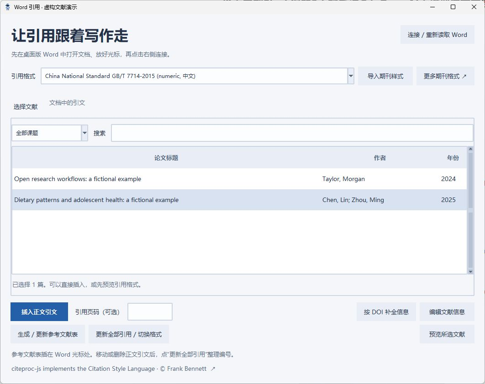

# Word 引用：从文献收藏到论文写作

此功能包含在 [PaperQuick v3.2](https://github.com/J0ey2ou/PaperQuick/releases/tag/v3.2.0) 中。支持 Windows 桌面版 Microsoft Word。电脑需要安装 Word，文献直达会在本机完成引用排版，无需 AI、账号或密钥。Word 导入、分页预览和 Word / PDF 转换另见 [文档与附件指南](documents-and-attachments.md)。

## 插入第一处引用

1. 在 Word 中打开正在撰写的文档，点击需要插入引用的位置。先取消正文文字选中。
2. 回到文献直达，进入 **文献分类 → Word 引用**。也可以选中文献，右键 **插入 Word 引用 / 参考文献**。
3. 点击 **连接 / 重新读取 Word**，核对窗口显示的文档名称。
4. 选择引用格式，在文献列表选中一篇或多篇论文；按住 Ctrl 或 Shift 可以多选。需要引用具体页面时，可填写“引用页码”。
5. 点击 **插入正文引文**。同一篇文献可以在不同位置重复引用，多篇文献也可以合并在一处。完成后按平时习惯在 Word 中保存文档。

插入动作来自文献直达的引用窗口，无需安装 Word 宏或修改宏安全设置。该窗口可以与 Word 来回切换；插入位置以操作时 Word 的光标为准。切到另一份文档后，请重新连接并核对名称。

## 生成参考文献表与切换格式

- **第一次生成文末列表**：在 Word 中将光标放到参考文献部分，再点击 **生成 / 更新参考文献表**。列表只包含这份文档中实际引用的文献。
- **换格式**：选好新的格式，点击 **更新全部引用 / 切换格式**。正文引文和参考文献表会一起更新。
- **修改引用顺序**：在 Word 中移动、增删引文后，点击 **更新全部引用**，重新整理编号、排序和列表。
- **替换或删除引文**：打开 **文档中的引文**，选择需要修改的一处。替换前，先在“选择文献”中选好新的论文；删除后其余引用与列表会一起更新。
- **撤销**：每次更新可以通过 Word 的撤销操作恢复。软件不会替你保存或覆盖 Word 文件。

## 常用格式与更多期刊

内置 31 套常用标准与期刊格式，包括国标 GB/T 7714、APA、Vancouver、IEEE、Chicago 作者年份、MLA、Harvard，以及 Nature、Science、Cell、The Lancet、NEJM、AMA 等。下拉列表显示实际提供的名称和版本；其他期刊还可导入自己的样式。

| 类别 | 内置格式 |
| --- | --- |
| 国标 | GB/T 7714—2015 数字编号、作者年份 |
| 常用标准 | APA、Vancouver / NLM、IEEE、Chicago 作者年份（当前及第 17 版）、MLA、Harvard Cite Them Right |
| 综合与医学期刊 | Nature、Science、Cell、The Lancet、NEJM、AMA（当前及第 10 版） |
| 学科协会 | ACS、APS、ACM |
| 出版社 | Elsevier Harvard / Vancouver、Springer Basic 作者年份 / 方括号、Springer Vancouver |
| 开放期刊及其他 | PLOS、BMJ、BMC、Frontiers、MDPI、ISO 690 作者年份 / 数字编号 |

点击 **预览所选文献** 可以核对作者、年份及正文引用文字。斜体、上标和段落排版以 Word 中的实际结果为准。

其他期刊可从 [CSL 样式库](https://www.zotero.org/styles) 获取 `.csl` 文件，然后点击 **导入期刊样式**。样式添加后保存在本地文献库中，后续排版不需要联网。当前引用功能适用于正文内的数字编号或作者年份样式，脚注、尾注型样式暂不支持。

## 信息不完整时怎么办

选中文献后，窗口会提示作者、年份、来源或页码等缺项。

- 点击 **编辑文献信息**，手动核对标题、作者、文献类型、卷期、页码、出版社等。
- 有 DOI 的文献可点 **按 DOI 补全信息**，从 Crossref 读取对应记录。只有这一步需要联网发送 DOI；不会上传 Word 内容、PDF 或笔记。
- 自动补全不一定包含所有字段，仍需核对。多位作者可用分号分隔；结构不清楚或已经省略为“等”的作者串，不会被擅自补成完整名单。
- 修改文献信息后，再点击 **更新全部引用**，将修正同步到打开的 Word 文档。

## 目前的适用范围

当前支持正文中的引用，暂不支持 Word 网页版、WPS、脚注或尾注中的引用。文档若处于只读、保护或修订状态，会提示先处理后再插入。文献直达只更新自己插入的引文，已有 EndNote、Zotero 或 Word 原生引文会保留，彼此不会混合编号。建议同一份论文选择一个工具统一管理引用。

复制粘贴整个动态引文可能带来重复标记；遇到提示时，删除那处复制的引文，再通过“插入正文引文”重新添加。引文内保留文献信息，重新打开文档后仍可继续更新；如果复制成纯文本，就失去了可更新关系。

## 开源格式支持

citeproc-js implements the Citation Style Language · © Frank Bennett. [Citation Style Language](https://citationstyles.org/)。

引用排版使用随程序提供的 citeproc-js，样式与语言文件来自 Citation Style Language 项目。原始许可证及来源信息保存在 `word-integration/vendor` 中。样式是现成的正式规则，不是由 AI 临时编写。

---

## English quick start

This feature is included in [PaperQuick v3.2](https://github.com/J0ey2ou/PaperQuick/releases/tag/v3.2.0). It requires Microsoft Word for Windows. Formatting runs locally; no AI service, account, API key, or Word macro is needed. See [Documents and attachments](documents-and-attachments.md#english) for import, paginated reading and Word/PDF conversion.

1. Open your document in Word and place the cursor where the citation belongs.
2. In PaperQuick, open **Library → Word citations**, then connect and verify the document name.
3. Select a style and one or more library items. Add an optional page locator and insert the citation.
4. Move the Word cursor to the bibliography section and generate the reference list.
5. After moving or deleting citations, editing metadata, or selecting another style, update all citations. Save the Word document normally.

Common numeric and author–date styles are bundled. Additional `.csl` styles can be imported from the [CSL repository](https://www.zotero.org/styles). Footnote/endnote styles, Word Online and WPS are not supported by this version. Existing EndNote/Zotero/native Word citations remain untouched and are not merged into PaperQuick numbering.

Use the metadata editor to correct author names, type, volume, issue, pages, and publisher. Optional DOI completion sends only the DOI to Crossref; it does not upload your manuscript, PDFs or notes. Each Word update is undoable and never automatically saves the document.
